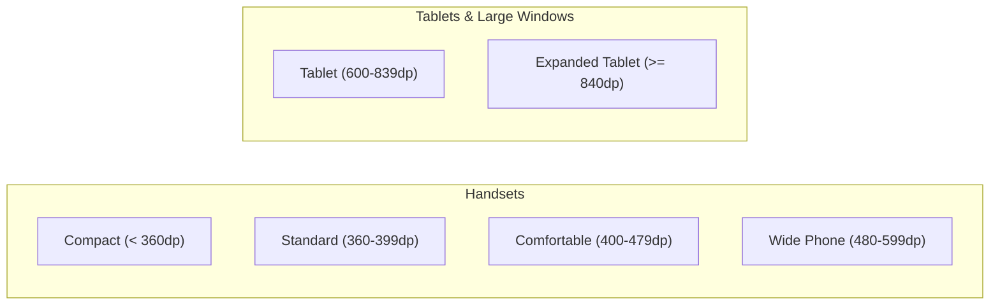
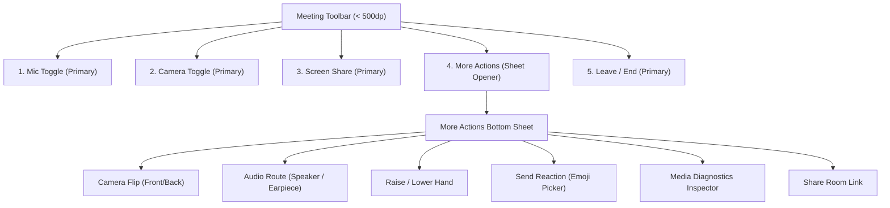

# TATHASTU MEET — M7 ADAPTIVE LAYOUT ARCHITECTURE
## UNIVERSAL PHONE & TABLET RESPONSIVE SYSTEM DESIGN

**Milestone:** M7 Universal Android Responsive UI/UX Engineering  
**Package:** `com.aitathastu.connect`  
**Repository:** `shiviiii5165/connect`  
**Authoritative Brand:** `https://connect.aitathastu.com/`  
**Hardware Reference:** Realme Pad RMP2107 (Android 12)  

---

### 1. Architectural Principles

1. **Space-Driven Adaptation (dp over Model Strings):**
   Android layouts must adapt strictly to available density-independent pixels (`dp`), safe-area insets, and orientation, rather than hardcoded device names or OEM brands.
2. **Preserve Tablet Golden Standard:**
   The approved visual layout, information hierarchy, and comprehensive control set of the Realme Pad tablet remain the golden visual baseline. Phone layouts adapt proportionally without degrading the tablet experience.
3. **No Feature Elimination (Progressive Disclosure):**
   All meeting actions (Microphone, Camera, Flip Camera, Screen Share, Raise Hand, Emoji Reactions, Audio Routing, Diagnostics, Leave/End) remain 100% available on every screen size. On compact viewports, secondary actions fold into an accessible, premium bottom sheet.
4. **Stable Media Transport Invariant:**
   Layout adjustments, window resizes, and orientation changes must never tear down WebRTC connections, unmount LiveKit tracks unnecessarily, or trigger room reconnections.

---

### 2. Viewport Breakpoint Hierarchy

| Width Tier | Width Range (dp) | Target Devices / Modes | Layout Strategy |
|---|---|---|---|
| **Compact** | `< 360dp` | Small handsets (e.g. 320dp, older devices, dense multi-window) | 1 column, slim header, hidden redundant labels, 5-action toolbar |
| **Standard** | `360dp – 399dp` | Most common Android handsets (Nord, Realme, Vivo, Pixel, Galaxy A) | 1 column, standard 16dp gutter, 5-action toolbar + More sheet |
| **Comfortable**| `400dp – 479dp` | Modern tall Android handsets (Galaxy S Ultra, Max devices) | 1 column with generous breathing room, 5-action toolbar |
| **Wide Phone** | `480dp – 599dp` | Foldables unfolded narrow, landscape phones, large phablets | 2 columns for room cards and feature showcases |
| **Tablet** | `600dp – 839dp` | Realme Pad portrait, 7-9" tablets, landscape phones | 2-3 columns, full 8-action toolbar in single row |
| **Expanded** | `>= 840dp` | Realme Pad landscape, 10-12" tablets, desktop DEX mode | 3-4 columns, maximum content width capped at 1040dp |

---

### 3. Height & Orientation Hierarchy

| Height Tier | Height Range (dp) | Context | Layout Strategy |
|---|---|---|---|
| **Short** | `< 500dp` | Handset in Landscape | Horizontal 2-column split (e.g. Prejoin preview on left, form on right; slim header/toolbar) |
| **Medium** | `500dp – 750dp` | Compact phones, phones with keyboard open | Clamped video preview height (~32-35% of stage), scrollable form |
| **Tall** | `> 750dp` | Modern tall handsets & tablet portrait | Generous vertical margins, centered cards, relaxed padding |

---

### 4. Meeting Controls Progressive Disclosure Specification

On Android handsets (< 500dp width in portrait), placing 8 buttons in a single row requires 473dp and causes broken wrapping.

The M7 architecture implements **Progressive Disclosure**:

#### On Tablets (>= 500dp)
All 8 buttons display simultaneously in a single, perfectly spaced row, preserving the approved Realme Pad layout.

---

### 5. Proportional Video Stage & PiP Geometry

#### 5.1 Local PiP Sizing
Instead of static `110x155`, PiP dimensions are calculated dynamically:
$$\text{PiP Width} = \operatorname{clamp}\left(76, \text{stageWidth} \times 0.24, 120\right)$$
$$\text{PiP Height} = \text{PiP Width} \times 1.414 \quad (\text{preserving standard 1:}\sqrt{2}\text{ mobile aspect ratio})$$

| Mode | PiP Dimensions | Stage Clearance |
|---|---|---|
| Compact Phone Portrait | 84dp × 118dp | 12dp bottom/right offset |
| Standard Phone Portrait| 96dp × 136dp | 14dp bottom/right offset |
| Landscape Phone | 76dp × 106dp | 10dp bottom/right offset, never overlaps toolbar |
| Tablet Baseline | 110dp × 155dp | 16dp bottom/right offset (Realme Pad baseline) |

#### 5.2 Remote Participant Grid Layouts
- **1 Remote Participant (Solo):** Full stage or waiting card.
- **2 Remote Participants:**
  - Phone Portrait: Vertical split (2 stacked tiles, each 50% height).
  - Phone Landscape / Tablet: Horizontal split (2 side-by-side tiles, each 50% width).
- **3–4 Remote Participants:** 2×2 grid with dynamic row height calculated from available stage height minus gutters.
- **Screen Share Active:** Presentation surface takes 100% of the stage container with `objectFit="contain"`, PiP floats at bottom-right without blocking presentation content.

---

### 6. Design Tokens & Component Integration

All tokens in `@tathastu/ui` and `apps/mobile/src/tokens.ts` are bound to adaptive scales:
- **Spacing Scale:** Multiplied by `spacingScale` (0.85 on compact, 1.0 on standard, 1.2 on tablet).
- **Typography Scale:** Clamped font scaling prevents extreme system font scale settings (e.g. 1.5x) from clipping essential buttons or breaking navigation headers.
- **Touch Target Accessibility:** All interactive elements maintain a minimum hit box of 44dp × 44dp in accordance with Android Material accessibility standards.

---

### 7. Android System Inset Handling

- The application uses `SafeAreaProvider` from `react-native-safe-area-context` at the root.
- All screen components query safe-area insets (`top`, `bottom`, `left`, `right`) to ensure no controls sit behind the camera cutout, status bar, gesture pill, or 3-button navigation bar.
- `android:windowSoftInputMode="adjustResize"` in `AndroidManifest.xml` operates alongside `KeyboardAvoidingView` to maintain visible inputs during chat composition and authentication.
