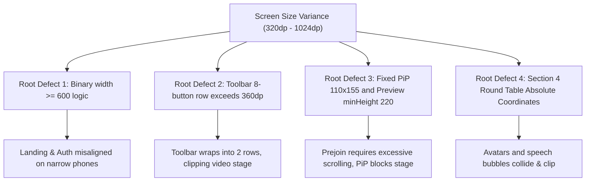

# TATHASTU MEET — M7 FORENSIC RESPONSIVE ROOT CAUSE AUDIT
## UNIVERSAL PHONE & TABLET COMPONENT-BY-COMPONENT DEFECT CATALOG

**Milestone:** M7 Universal Android Responsive UI/UX Engineering  
**Package:** `com.aitathastu.connect`  
**Repository:** `shiviiii5165/connect`  
**Target Architecture:** Android Handsets (320dp – 599dp) & Tablets (600dp – 1024dp+)  
**Golden Reference Tablet:** Realme Pad RMP2107 (Android 12, Helio G80)  
**Golden Web Reference:** `https://connect.aitathastu.com/`  

---

### Executive Summary

Physical testing on phones (including OnePlus Nord, Realme phones, Vivo phones, Samsung Galaxy, and Pixel handset viewports) revealed visual degradation and layout misalignments not present on the Realme Pad tablet. 

This audit pinpoints the exact root causes in the React Native layout tree:
1. **Binary Breakpoint Fallacy:** Code relied solely on `width >= 600` (Tablet) vs `< 600` (Phone). Handsets ranging from 320dp to 430dp were treated identically, while landscape handsets (width > 600, height < 450) were misclassified as tablets or forced into rigid portrait stacks.
2. **Fixed Pixel & Percentage Dimensions:** Hardcoded widths (e.g. 110x155 PiP, 220px minHeight preview, 44px * 8 toolbar items) exceeded available dp on standard phone viewports.
3. **Rigid Absolute Coordinates:** Constellation elements (such as the Section 4 Research Round Table) used fixed coordinate percentages that collided and clipped on screens under 500dp.
4. **Bottom Toolbar Row Overflow:** Meeting controls required a minimum of 473dp to display in a single row. On phones (320–430dp), this triggered awkward 2-row button wrapping that pushed the video stage off-balance.

---

### Component-by-Component Root Cause Analysis



---

#### 1. Adaptive Foundation & Dimension Hook
- **Component:** `apps/mobile/src/hooks/useWindowDimensions.ts`
- **Existing Constraint:** Simply returns `Dimensions.get('window')` with no classification of width tier, height tier, orientation, safe area insets, font scale, or touch targets.
- **Affected Viewports:** All phones (< 600dp), especially 320dp (compact), 360–393dp (standard), 400–430dp (comfortable), and all landscape phones.
- **Why it breaks:** Individual screens invent ad-hoc `width >= 600` checks. No unified layout engine exists to provide adaptive spacing, column counts, or font clamping.
- **Visual Symptom:** Disjointed spacing, inconsistent margins, text truncation or awkward wrapping across different phone brands.
- **Planned Smallest Safe Correction:** Expand `useWindowDimensions` into a universal responsive layout hook `useAdaptiveLayout` providing typed width classes (`compact`, `standard`, `comfortable`, `wide`, `tablet`, `expandedTablet`), orientation flags, safe inset handling, and dynamic scaling utilities.

---

#### 2. LandingScreen — Navigation Header (Section 1)
- **Component:** `LandingScreen.tsx` (`styles.navBar`, `styles.brandRow`, `styles.navActionsRow`, `styles.userSection`)
- **Existing Constraint:** 
  ```tsx
  brandTitle: { fontSize: 18, fontWeight: '800' }
  brandLogo: { width: 32, height: 32 }
  navActionsRow: { flexDirection: 'row', gap: 8 }
  ```
- **Affected Viewports:** Compact and standard phones (320dp – 390dp width).
- **Why it breaks:** On 320dp width, with 32dp container padding, available width is only 288dp. When authenticated, the header attempts to fit: Logo (32) + Gap (8) + "Tathastu Meet" (120) + User Avatar (32) + "Sign out" (64) + "Start free" (82) + gaps (32) = 370dp. This exceeds 288dp by 82dp!
- **Visual Symptom:** Logo and title collide with action buttons; "Sign out" or "Start free" overflows the screen edge or wraps into an unintended second line.
- **Planned Smallest Safe Correction:**
  - On compact phones (< 380dp), conditionally truncate or adjust brand title size (`Tathastu Meet` -> `Meet` or responsive font size).
  - Use compact padding and icon-only or streamlined action buttons on narrow viewports.
  - Preserve full title, avatar, and text buttons on tablets and wide handsets.

---

#### 3. LandingScreen — Hero & Room Code Input (Section 2)
- **Component:** `LandingScreen.tsx` (`styles.heroHeadline`, `styles.heroActionsRow`, `styles.roomCodeContainer`)
- **Existing Constraint:**
  ```tsx
  heroHeadline: { fontSize: 34, lineHeight: 40 }
  roomCodeContainer: { minHeight: 52, maxWidth: 360, width: '100%', paddingLeft: 16, paddingRight: 6 }
  roomCodeLabel: { fontSize: 14, marginRight: 6 }
  roomCodeJoinBtn: { paddingHorizontal: 20, minHeight: 44 }
  ```
- **Affected Viewports:** 320dp – 375dp handsets.
- **Why it breaks:** In `roomCodeContainer`, the static label "Room code" (68dp) + "Join" button (62dp) + padding (22dp) = 152dp. On a 320dp screen (content width ~288dp), the text input is crushed into ~136dp, causing placeholder "abc-defg-hij" to truncate and typed codes to feel cramped.
- **Visual Symptom:** Clipped room code input, headline line-breaks creating single orphan words, category pills overflowing horizontally.
- **Planned Smallest Safe Correction:**
  - Scale `heroHeadline` responsively: 26–28px on compact phones, 32px on standard phones, 54px on tablets.
  - In `roomCodeContainer`, dynamically hide the redundant static label "Room code" on compact phones in favor of an informative placeholder.
  - Ensure pills wrap with calibrated horizontal spacing.

---

#### 4. LandingScreen — Hero Meeting Showcase (Section 3)
- **Component:** `LandingScreen.tsx` (`styles.showcaseWindowCard`, `styles.sideTilesCol`, `styles.simulatedControlsBar`)
- **Existing Constraint:**
  ```tsx
  sideTilesCol: { flexDirection: 'row', gap: 8, justifyContent: 'space-between' }
  simControlCircle: { width: 42, height: 42 } // 4 circles + 1 pill (54px) + gaps = 262dp
  ```
- **Affected Viewports:** 320dp – 390dp phones.
- **Why it breaks:** 
  1. `sideTilesCol` places 3 participant tiles in a single row on phones. On a 320dp phone, available width inside the showcase card is only ~250dp (~75dp per participant). "Sanara Singh" cannot fit on one line and wraps tightly or overlaps.
  2. `simulatedControlsBar` takes 262dp minimum width, crowding the card edges on small screens.
- **Visual Symptom:** Cramped side tiles, truncated participant names, simulated buttons touching card borders.
- **Planned Smallest Safe Correction:**
  - Scale simulated control buttons dynamically (34–38dp on compact phones, 42dp on tablets).
  - Use responsive name abbreviation or single-line ellipsis for showcase participant badges.
  - Adapt card padding from 12dp down to 8dp on narrow devices.

---

#### 5. LandingScreen — Research Round Table (Section 4)
- **Component:** `LandingScreen.tsx` (`styles.roundTableContainer`, `styles.centralTableOval`, `anantBubble`, `sanaraBubble`, `nehaBubble`)
- **Existing Constraint:**
  ```tsx
  roundTableContainer: { height: 340, maxWidth: 580 }
  anantBubble: { position: 'absolute', top: 0, right: '16%', maxWidth: 130 }
  sanaraBubble: { position: 'absolute', left: 2, top: '12%', maxWidth: 115 }
  nehaBubble: { position: 'absolute', right: 4, bottom: '22%', maxWidth: 120 }
  ```
- **Affected Viewports:** Handsets with width < 420dp.
- **Why it breaks:** Fixed pixel widths and percentage offsets designed on a 700dp+ tablet canvas cause speech bubbles to overlap central table text and avatar circles when container width shrinks to 300–350dp.
- **Visual Symptom:** Speech bubbles overlap participant faces; table text "Multimodal AI Research Circle" is obscured; bubbles clip outside container boundaries.
- **Planned Smallest Safe Correction:**
  - Introduce an adaptive compact roundtable layout:
    - On tablets / wide viewports: preserve the approved full constellation.
    - On narrow handsets (< 400dp): scale avatar sizes (34–38dp), adjust bubble widths and positioning to prevent overlap, or arrange speech quotes in an integrated, elegant round-table flow that preserves all 5 named participants (Anant, Sanara, Shivam, Prof. Rao, Neha).

---

#### 6. LandingScreen — Room Categories & Feature Sections (Sections 5 to 10)
- **Component:** `LandingScreen.tsx` (`styles.roomGrid`, `styles.featureRow`, `styles.footerGrid`)
- **Existing Constraint:**
  ```tsx
  roomGridTablet: { flexDirection: 'row', flexWrap: 'wrap' }
  // On phones: single column only, regardless of wide phone or landscape width
  ```
- **Affected Viewports:** Wide phones (480–599dp) and landscape phones (height < 500dp).
- **Why it breaks:** Stacking 5 category cards in 1 column on wide screens creates excessive vertical scrolling. Feature cards lack width bounds and don't take advantage of 2-column opportunities when width permits.
- **Visual Symptom:** Endless vertical scroll on landscape phones; footer links spread sparsely.
- **Planned Smallest Safe Correction:**
  - Support a 2-column card grid on wide phones (400–599dp) while keeping 1 column on compact phones (< 400dp) and 3 columns on tablets (>= 600dp).
  - Responsive footer reflow.

---

#### 7. SignInScreen — Authentication Form Card
- **Component:** `SignInScreen.tsx` (`styles.content`, `styles.scrollContainer`, `styles.tabRow`)
- **Existing Constraint:**
  ```tsx
  content: { maxWidth: 460, padding: 28, borderRadius: 24 }
  scrollContainer: { paddingHorizontal: 20, paddingVertical: 24 }
  ```
- **Affected Viewports:** Compact phones (320–360dp) and landscape phones.
- **Why it breaks:** 
  1. Card padding (28 * 2 = 56dp) + outer padding (20 * 2 = 40dp) consumes 96dp. On a 320dp screen, usable form input width is only 224dp.
  2. Tab button text "Create Account" wraps on narrow widths.
  3. In landscape orientation or when keyboard opens on Android, `KeyboardAvoidingView` behavior `undefined` leaves active inputs hidden behind the keyboard.
- **Visual Symptom:** Cramped input fields, cropped button text, keyboard obscuring password field and submit button.
- **Planned Smallest Safe Correction:**
  - Adapt card padding (18–20dp on compact phones, 28dp on tablets).
  - Scale tab button padding and typography to prevent wrapping.
  - Implement robust scroll-view padding with keyboard auto-scroll.

---

#### 8. PrejoinScreen — Camera Preview & Controls Sizing
- **Component:** `PrejoinScreen.tsx` (`styles.videoPreview`, `styles.previewControls`, `styles.mainWrapper`)
- **Existing Constraint:**
  ```tsx
  videoPreview: { aspectRatio: 16 / 10, minHeight: 220 }
  previewControls: { position: 'absolute', bottom: 14, flexDirection: 'row', gap: 10 }
  const isTablet = Math.min(width, height) >= 600;
  const useTwoColumn = isTablet && isLandscape;
  ```
- **Affected Viewports:** Compact portrait phones (< 380dp) and all landscape phones (e.g. 740x360).
- **Why it breaks:**
  1. `minHeight: 220` with top bar (60dp) + status badge (40dp) + form inputs (240dp) requires > 600dp vertical space, pushing "Join Room" button below fold on short phones.
  2. `previewControls` has 3 buttons ("Mic On" ~70px + "Cam On" ~74px + "Flip" ~55px + gaps) = ~220dp. On a 320dp phone with 40dp margins, preview width is 280dp, causing buttons to touch the edge or clip.
  3. On a phone rotated to landscape, `isTablet` evaluates to `false` because `Math.min(740, 360) = 360 < 600`. Thus `useTwoColumn` is FALSE, forcing an unreadable single-column stack onto a 360dp high screen!
- **Visual Symptom:** Join button pushed far off-screen; toggle buttons crowded; unusable layout on landscape phones.
- **Planned Smallest Safe Correction:**
  - Enable two-column layout on ANY device in landscape where width >= 560dp and height < 500dp.
  - Dynamically size preview height based on available viewport height (e.g. max 32% of screen height in portrait phone).
  - Compact toggle button padding on narrow screens.

---

#### 9. MeetingScreen — Bottom Toolbar Overflow (HIGHEST PRIORITY P0)
- **Component:** `MeetingScreen.tsx` (`styles.controlsBar`, `styles.controlBtn`, `styles.leaveBtn`)
- **Existing Constraint:**
  ```tsx
  controlsBar: {
    flexDirection: 'row',
    alignItems: 'center',
    justifyContent: 'center',
    paddingVertical: 12,
    paddingHorizontal: 12,
    gap: 8,
    flexWrap: 'wrap',
  }
  controlBtn: { width: 44, height: 44 } // 7 buttons @ 44dp = 308dp
  leaveBtn: { height: 44, paddingHorizontal: 16 } // ~85dp
  // Total: 308 + 85 + 7*8 gap + 24 padding = 473dp minimum width
  ```
- **Affected Viewports:** ALL Android phones (320dp, 360dp, 375dp, 393dp, 412dp, 430dp).
- **Why it breaks:** No standard Android handset has a 473dp portrait width. With `flexWrap: 'wrap'`, 2 to 4 buttons wrap to a second line. This doubles the toolbar height, clips the video stage, and misplaces the "Leave" button.
- **Visual Symptom:** 
  - On 360dp phone: 5 buttons on line 1, 3 buttons on line 2.
  - On 393dp phone: 6 buttons on line 1, 2 buttons on line 2.
  - Video stage height collapses or gets covered.
- **Planned Smallest Safe Correction:**
  - Implement an **Adaptive Meeting Toolbar with Progressive Disclosure**:
    - **Compact / Standard Phone (< 500dp):** Display 5 primary actions in a single clean row:
      1. Microphone (toggle)
      2. Camera (toggle)
      3. Screen Share (toggle)
      4. More Actions (opens a bottom sheet with Flip Camera, Audio Output/Speaker, Raise Hand, Reaction Picker, Diagnostics)
      5. Leave / End (destructive action)
    - **Tablet / Wide Handset (>= 500dp):** Preserve the full comprehensive 8-button row as approved on the Realme Pad baseline.
    - Zero functionality removed: all actions remain 1-tap accessible.

---

#### 10. MeetingScreen — Video Stage, Grid & Local PiP
- **Component:** `MeetingScreen.tsx` (`styles.localPip`, `styles.remoteGridContainer`, `styles.remoteTile`)
- **Existing Constraint:**
  ```tsx
  localPip: {
    position: 'absolute',
    bottom: 16,
    right: 16,
    width: 110,
    height: 155, // Fixed 110x155
  }
  remoteTile: { minHeight: 180, margin: 4 }
  remoteTileTwo: { minWidth: '47%', flex: 1 } // Side-by-side on portrait phone
  ```
- **Affected Viewports:** Handsets in portrait and landscape.
- **Why it breaks:**
  1. A fixed 110x155 PiP covers ~35% of the screen height in landscape (360dp height).
  2. With 2 participants on portrait phone, side-by-side tiles (`minWidth: 47%`) produce squished, nearly square tiles that crop wide video feeds. A top/bottom stacked grid is the standard mobile pattern.
  3. `minHeight: 180` forces multi-participant grids to overflow vertically on small screens.
- **Visual Symptom:** PiP blocks remote participants and name tags; side-by-side remote video feeds are aggressively cropped on portrait phones.
- **Planned Smallest Safe Correction:**
  - Calculate PiP dimensions proportionally:
    - Phone portrait: ~88dp x 124dp (clamped within stage safe bounds).
    - Phone landscape: ~76dp x 108dp.
    - Tablet: ~120dp x 170dp (preserving Realme Pad aesthetic).
  - Adaptive participant grid:
    - 2 participants in portrait phone: vertical stack (50% / 50% stage height).
    - 2 participants in landscape or tablet: side-by-side (50% / 50% stage width).
    - 3-4 participants: balanced 2x2 grid with proportional height calculation.
    - Ensure VideoView uses `objectFit="cover"` for cameras and `objectFit="contain"` for screen shares.

---

#### 11. In-Meeting Modals & Drawers (Chat, Participants, More Menu)
- **Component:** `MeetingScreen.tsx` (`styles.modalContainer`, `styles.chatInputRow`, `styles.modalOverlay`)
- **Existing Constraint:**
  ```tsx
  modalContainer: { maxHeight: '80%', minHeight: '50%' }
  KeyboardAvoidingView: { behavior: Platform.OS === 'ios' ? 'padding' : undefined }
  ```
- **Affected Viewports:** Phones with soft keyboard open, gesture navigation, and three-button navigation bars.
- **Why it breaks:** On Android, when the software keyboard opens, chat messages and the text input field can be pushed off-screen or obscured depending on status bar and navigation bar insets.
- **Visual Symptom:** Chat send button hidden behind keyboard; participants sheet overflows screen height in landscape.
- **Planned Smallest Safe Correction:**
  - Add responsive height bounds for modals: in landscape, expand to 94% height with two-column or compact layout; in portrait, use 75–85% height.
  - Ensure `windowSoftInputMode="adjustResize"` works cleanly with React Native safe area insets.

---

### Defect Traceability Matrix

| # | Screen / Area | Primary Root Cause | Affected Widths | Severity | Planned Fix |
|---|---|---|---|---|---|
| **D1** | System Foundation | Absence of responsive layout hook | All (< 600dp) | P0 | Create `useAdaptiveLayout` with typed width classes |
| **D2** | Landing Header | Action buttons & logo exceed width | 320–380dp | P1 | Responsive brand title & compact action layout |
| **D3** | Landing Hero | Room code label crushes text input | 320–375dp | P1 | Dynamic label suppression & font scaling |
| **D4** | Showcase Card | 3 participant tiles in single row | 320–380dp | P1 | Calibrated button sizing & responsive tiles |
| **D5** | Round Table | Hardcoded absolute coordinates & widths | < 420dp | P1 | Adaptive compact constellation layout |
| **D6** | Room Grid | 1-col on all phones, even landscape | 480–840dp | P2 | 2-column grid on wide phones and landscape |
| **D7** | Auth Screen | Excessive card padding & keyboard clipping | 320–360dp, landscape | P1 | Responsive padding & keyboard handling |
| **D8** | Prejoin Screen | Preview minHeight 220; 1-col in landscape | < 380dp, landscape | P0 | Flexible preview height & landscape 2-col |
| **D9** | Meeting Toolbar | 8 buttons require 473dp -> 2-row wrap | 320–480dp | P0 | Progressive disclosure "More" sheet on phones |
| **D10**| Video Stage & PiP| Hardcoded 110x155 PiP; 2-tile side-by-side | All phones | P0 | Proportional PiP & orientation-aware grid |
| **D11**| Chat & Modals | Modal height in landscape; keyboard push | Landscape & phones | P1 | Landscape-aware sheet heights & insets |

---

### Conclusion & Implementation Sequence

The defects identified above are strictly layout and responsive geometry issues. None require modifying LiveKit signalling, WebRTC transport, room authentication, or chat protocol contracts.

The execution will follow the required order:
1. Universal Adaptive Layout Hook & Engine (`apps/mobile/src/hooks/useAdaptiveLayout.ts`)
2. Design System Components & Token System
3. Landing Page Universal Responsiveness (all 10 sections preserved)
4. Sign In & Create Account Form Responsiveness
5. Prejoin Screen Adaptive Redesign
6. Meeting Screen Video Stage, Proportional PiP & Adaptive Toolbar
7. Overlays, Chat, Participants & More Actions Sheet
8. Test Verification & Documentation
