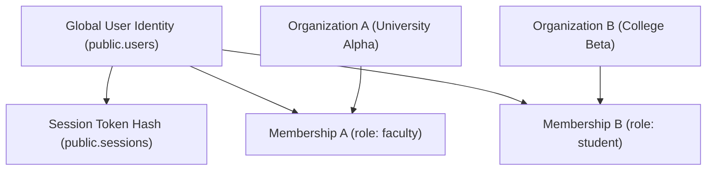
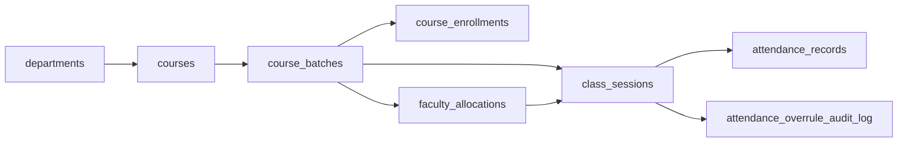

# Connect C0 — Final Architecture Specification

## 1. Executive Summary & Architectural Scope
Connect is a high-reliability, real-time institutional communication and academic collaboration platform. This document establishes the finalized, production-grade C0 architectural baseline across multi-tenancy, institutional hierarchy, personal collaboration nodes, durable attendance reconciliation, and asynchronous task execution.

---

## 2. Global Identity vs. Multi-Institutional Tenancy


### 2.1 Identity Principles
- **Global User Entity (`public.users`)**: Contains global credentials (email, password_hash, user status) with zero tenant foreign keys.
- **Organization Memberships (`public.organization_memberships`)**: Represents the active institutional association of a user within a specific institution (`organization_id`, `user_id`, `role`, `status`). A user may hold concurrent memberships across distinct organizations with differing roles.
- **Tenant Context Binding**: Application transactions explicitly select and cryptographically bind a single active tenant context (`app._org_id`) via `connect_auth.authenticate_session` prior to executing multi-tenant operations.

---

## 3. Four-Tier Workspace Classification Model
```text
┌────────────────────────────────────────────────────────────────────────┐
│                        WORKSPACE TOPOLOGY                              │
├────────────────────────────┬───────────────────────────────────────────┤
│ Workspace Type             │ Authorization Boundary                    │
├────────────────────────────┼───────────────────────────────────────────┤
│ institutional              │ Scoped to organization_id. Requires       │
│                            │ active membership or platform admin.      │
├────────────────────────────┼───────────────────────────────────────────┤
│ personal_workspace         │ Private sandbox strictly owned and        │
│                            │ accessed by host_user_id.                 │
├────────────────────────────┼───────────────────────────────────────────┤
│ personal_commons           │ Public collaboration nodes; open entry,   │
│                            │ but notes/files are author-exclusive.     │
├────────────────────────────┼───────────────────────────────────────────┤
│ quarantine_unclassified    │ Unattributable historical legacy rooms;   │
│                            │ permanently locked (is_locked = true).    │
└────────────────────────────┴───────────────────────────────────────────┘
```

---

## 4. Academic Hierarchy & Attendance Engine


### 4.1 Durable Attendance Reconciliation
- Real-time connection events are streamed into `participant_connection_events` (append-only ledger).
- Attendance calculation aggregates verified join/leave intervals against scheduled session boundaries.
- Any manual modification by faculty or institutional admins creates an immutable audit row in `attendance_overrule_audit_log`.

---

## 5. Asynchronous Outbox & Worker Engine
- **Transactional Outbox (`background_jobs`)**: Background jobs are enqueued within the same database transaction as domain state mutations.
- **Monotonic Fencing Tokens**: Distributed workers claim jobs with `SELECT FOR UPDATE SKIP LOCKED` and increment a monotonic fencing token. Any stale worker attempting to write back an expired lease is rejected.
