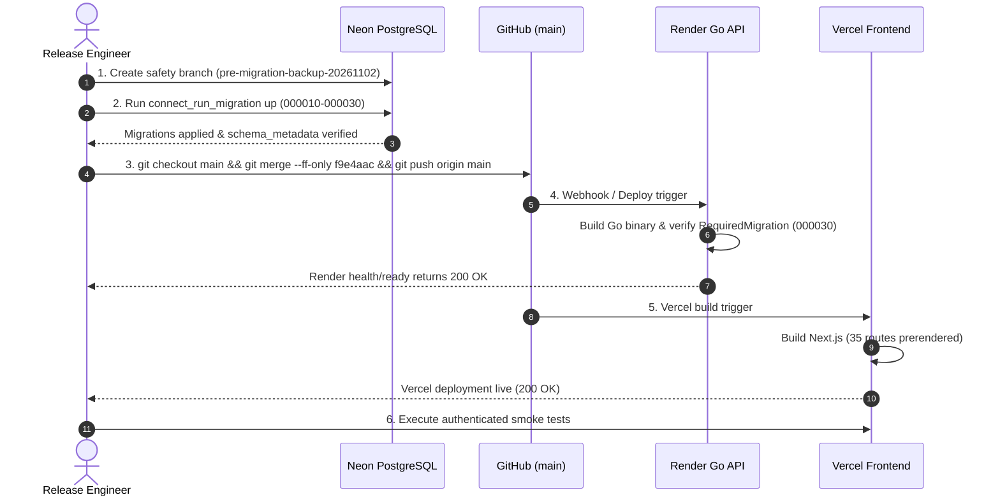

# Connect — Phase 4 Production Cutover Runbook

**Target Architecture:** Connect Virtual Classroom & Practical Learning Platform  
**Target Release Candidate:** `f9e4aaca70992dbc8b12a2dbb2fe1fc11b5144a3`  
**Feature Branch:** `feat/phase-4-practical-learning`  
**Upstream Main:** `d31b718ec3b6b95db2a1f98d280f38a6b1f15bb0`  
**Runbook Version:** 1.0.0  
**Effective Date:** 2026-11-02  
**Infrastructure Budget:** ₹0 (Strict Free Tier Compliance)  
**Classification:** Operational Release Runbook (Requires Human Execution Sign-off)

---

## 1. Executive Summary & Objective

This runbook defines the exact, sequential, zero-downtime production cutover procedure for the **Connect Phase 4 Practical Learning Platform** upgrade.

The release incorporates:
- Database migrations `000010` through `000030` (trusted sessions, attendance RLS, role separation, break-out rooms, notifications, academic modules, and the 7 practical lab/assignment tables).
- Go API backend with strict identity verification, fail-closed migration enforcement (`RequiredMigration = "000030_practical_lab_and_assignments"`), role-separated database connections (`connect_app` and `connect_worker`), and multi-tenant lab APIs.
- Next.js frontend with 5 practical course hubs (DSA, OOPS, Web Dev, Python, DBMS), Pyodide Web Worker execution, SQLite WASM sandbox, HTML/CSS/JS preview, assignment solver with hidden test case confidentiality, and faculty grading interfaces.
- Safe blocking of C++ and Java execution until zero-cost secure sandbox infrastructure is provisioned.

---

## 2. Release Candidate & Deployment Topology

### 2.1 Git Release Candidate
- **Release Commit SHA:** `f9e4aaca70992dbc8b12a2dbb2fe1fc11b5144a3`
- **Branch:** `feat/phase-4-practical-learning`
- **Target Upstream Branch:** `main`
- **Merge Strategy:** Fast-Forward Only (`git merge --ff-only`). Rebase or squash is prohibited.

### 2.2 Live Production Environments
| Service | Platform | Resource ID / URL | Current Live Commit | Target Commit |
| :--- | :--- | :--- | :--- | :--- |
| **Database** | Neon Serverless PostgreSQL | `late-night-b4r5iy1t` (`ep-sweet-block-b4g7rmvt`) | Migrations 000001–000009 | Migrations 000001–000030 |
| **Backend API** | Render Web Service | `srv-dbj507nlk1mc73897go0` (`connect-a2fi.onrender.com`) | `213d517` | `f9e4aac` |
| **Frontend Web** | Vercel Edge Network | `connect-alpha-seven` (`connect-alpha-seven.vercel.app`) | `910d501` | `f9e4aac` |

---

## 3. Preflight Readiness Verification

Before initiating any production modification, execute the following non-destructive preflight checks:

### 3.1 Live Service Health Check
```bash
# Verify current Render API health
curl -s -i https://connect-a2fi.onrender.com/health/ready
# Expected: HTTP 200 OK {"status":"ok"}

# Verify live Vercel frontend availability
curl -s -i -o /dev/null -w "%{http_code}\n" https://connect-alpha-seven.vercel.app
# Expected: 200
```

### 3.2 Git Tree Cleanliness Check
```bash
git checkout feat/phase-4-practical-learning
git merge-base --is-ancestor main HEAD && echo "CLEAN ANCESTRY CONFIRMED"
# Expected: CLEAN ANCESTRY CONFIRMED
```

---

## 4. Production Cutover Execution Sequence

The cutover follows a strict, non-breaking order of operations:
1. **Safety Backup**: Create pre-migration Neon snapshot branch.
2. **Database Migration**: Apply migrations `000010`–`000030` using `neondb_owner`.
3. **Role Grants**: Validate table grants for `connect_app` and `connect_worker`.
4. **Git Merge**: Fast-forward merge release candidate into `main`.
5. **Backend Deployment**: Trigger and verify Render Go API build and startup.
6. **Frontend Deployment**: Trigger and verify Vercel Next.js build and routing.
7. **Post-Cutover Smoke Tests**: Authenticated functional verification.



---

### Step 1 — Pre-Migration Neon Safety Snapshot

Under Neon Free tier, Point-in-Time Recovery (PITR) has a 24-hour retention window. Create an instantaneous point-in-time branch before running migrations to guarantee instantaneous, zero-loss rollback capability.

**Execution via Neon CLI or Console:**
```bash
# Using Neon API / CLI:
neon branches create \
  --project-id late-night-b4r5iy1t \
  --parent main \
  --name pre-migration-backup-20261102
```
*Verification:* Confirm branch `pre-migration-backup-20261102` exists in Neon Console before proceeding.

---

### Step 2 — Database Migration Execution (`000010`–`000030`)

Migrations must run using the direct compute URL (`DATABASE_DIRECT_URL`) under administrative credentials (`neondb_owner`). Each migration executes inside its own transaction guarded by `pg_advisory_lock(987654321)`.

```bash
# Execute migrations from repo root using production DIRECT_URL
DATABASE_URL="$DATABASE_DIRECT_URL" ./connect-main/services/api/cmd/run_migration/run_migration up
```

**Post-Migration Validation Queries:**
```sql
-- 1. Verify schema metadata records migration 000030
SELECT version, applied_at 
FROM schema_metadata 
ORDER BY applied_at DESC 
LIMIT 5;

-- Expected: 000030_practical_lab_and_assignments as the latest applied migration

-- 2. Verify RLS is enabled and forced on all 7 new lab tables
SELECT c.relname, c.relrowsecurity, c.relforcerowsecurity
FROM pg_class c
JOIN pg_namespace n ON n.oid = c.relnamespace
WHERE n.nspname = 'public' 
  AND c.relname IN (
    'lab_courses', 'lab_modules', 'lab_exercises', 'lab_test_cases',
    'lab_assignments', 'lab_assignment_test_cases', 'lab_submissions'
  )
ORDER BY c.relname;

-- Expected: relrowsecurity = true, relforcerowsecurity = true for all 7 tables

-- 3. Verify runtime role grants
SELECT grantee, table_name, privilege_type 
FROM information_schema.role_table_grants 
WHERE table_name IN ('lab_courses', 'lab_assignments', 'lab_submissions')
  AND grantee IN ('connect_app', 'connect_worker')
ORDER BY table_name, grantee;
```

---

### Step 3 — Git Fast-Forward Merge

Fast-forward merge `feat/phase-4-practical-learning` into `main` without creating a merge commit:

```bash
git checkout main
git pull --ff-only origin main
git merge --ff-only f9e4aaca70992dbc8b12a2dbb2fe1fc11b5144a3
git push origin main
```

---

### Step 4 — Render Go API Deployment

1. **Verify Environment Variables on Render Service `srv-dbj507nlk1mc73897go0`**:
   - `DATABASE_URL`: `connect_app` connection string (or pooled connection string with channel binding).
   - `WORKER_DATABASE_URL`: `connect_worker` connection string.
   - `GOOGLE_CLIENT_IDS`: `508137393515-5ij90sbgb82ceqp3dbrgq1mf7f2j16a8.apps.googleusercontent.com`
   - `RATE_LIMIT_ENABLED`: `true`
   - `APP_ENV`: `production`

2. **Trigger Deployment**:
   - If auto-deploy is enabled, pushing to `main` starts the build.
   - If manual, trigger via Render Dashboard or Render API:
     ```bash
     curl -X POST "https://api.render.com/v1/services/srv-dbj507nlk1mc73897go0/deploys" \
       -H "Authorization: Bearer $RENDER_API_KEY" \
       -H "Content-Type: application/json" \
       -d '{"clearCache": "do_not_clear"}'
     ```

3. **Verify Build & Startup Logs**:
   Look for the following log events in Render console:
   ```text
   database_identity_verified role=connect_app required_migration=000030_practical_lab_and_assignments
   server listening on port 8080
   ```

4. **Verify Health Endpoint**:
   ```bash
   curl -s https://connect-a2fi.onrender.com/health/ready
   # Expected: {"status":"ok"}
   ```

---

### Step 5 — Vercel Frontend Deployment

1. **Verify Environment Variables on Vercel (`connect-alpha-seven`)**:
   - `INTERNAL_API_URL`: `https://connect-a2fi.onrender.com`
   - `NEXT_PUBLIC_GOOGLE_CLIENT_ID`: `508137393515-5ij90sbgb82ceqp3dbrgq1mf7f2j16a8.apps.googleusercontent.com`
   - `NEXT_PUBLIC_APP_ORIGIN`: `https://connect-alpha-seven.vercel.app`

2. **Monitor Build**:
   - Push to `main` triggers automatic deployment.
   - Verify: 35/35 routes prerendered, 0 TypeScript errors, 103 kB shared bundle.

3. **Verify Frontend Route**:
   ```bash
   curl -s -i https://connect-alpha-seven.vercel.app/lab
   # Expected: HTTP 200 OK
   ```

---

## 5. Post-Deployment Smoke Test Protocol

Execute the following 5 smoke test journeys immediately following cutover:

| Test ID | Journey | Target Route | Expected Result | Pass Criteria |
| :--- | :--- | :--- | :--- | :--- |
| **ST-01** | Landing & Lab Navigation | `/lab` | Course hub directory loads with 5 tracks | HTTP 200, tracks visible |
| **ST-02** | Python Web Worker Execution | `/lab/editor` | Pyodide computes factorial in browser worker | Execution completes < 2.5s |
| **ST-03** | SQLite WASM Execution | `/lab/sql` | Creates table, inserts rows, runs SELECT | Relational result table rendered |
| **ST-04** | Hidden Test Confidentiality | `/lab/assignments/:id` | Public tests visible; hidden tests masked | Zero hidden test data in DOM/RSC |
| **ST-05** | Faculty Review Modal | `/lab/faculty` | Submissions queue displayed; review modal opens | Grade and feedback inputs operable |

---

## 6. Rollback Runbook & Procedures

If any critical issue arises during cutover, follow the graduated rollback protocol below:

### 6.1 Rollback Decision Criteria
Trigger rollback immediately if:
- Render API fails to start (`crash_loop` or exit 1 due to database connection error).
- `/health/ready` returns non-200 for > 5 consecutive minutes.
- Frontend experiences fatal JS bundle errors blocking meeting or lab access.
- Data corruption or cross-tenant data leakage is observed.

### 6.2 Frontend Rollback (T+1 minute)
In Vercel Dashboard -> Deployments:
1. Locate deployment `910d501` (pre-cutover production build).
2. Click **Instant Rollback** / **Promote to Production**.
3. Verify `https://connect-alpha-seven.vercel.app` serves commit `910d501`.

### 6.3 API Rollback (T+3 minutes)
In Render Dashboard -> Service `srv-dbj507nlk1mc73897go0`:
1. Re-deploy previous successful build `dep-dbk8k4ajnfac739tpotg` (commit `213d517`).
2. Verify API status returns to `live` and `/health/ready` returns `{"status":"ok"}`.

### 6.4 Database Rollback (T+5 minutes)
Because migrations `000010`–`000030` are non-breaking and purely additive, the old API (`213d517`) operates without errors on the migrated database.

If a database-level rollback is explicitly mandated:
1. **Option A (Targeted Rollback of Migration 000030)**:
   ```bash
   psql "$DATABASE_DIRECT_URL" -f tests/sql/rollback_000030.sql
   ```
   *Action:* Safely drops the 7 practical learning tables and `can_manage_lab_course` helper, removing `000030` from `schema_metadata`.
2. **Option B (Point-in-Time Branch Swap via Neon Console)**:
   Promote `pre-migration-backup-20261102` to primary branch.

---

## 7. Operational Sign-off Checklist

| Gate | Requirement | Responsible Party | Signed Off? |
| :--- | :--- | :--- | :--- |
| **G-01** | Git clean ancestry & exact commit SHA (`f9e4aac`) | QA Release Manager | [ ] |
| **G-02** | Neon backup branch created (`pre-migration-backup-20261102`) | PostgreSQL Specialist | [ ] |
| **G-03** | Migrations 000010–000030 applied with zero errors | Database Lead | [ ] |
| **G-04** | Render Go API healthy (`/health/ready` 200 OK) | DevOps Lead | [ ] |
| **G-05** | Vercel Next.js 35 routes live | Frontend Lead | [ ] |
| **G-06** | Post-cutover smoke tests passed (ST-01 to ST-05) | Principal QA Lead | [ ] |
| **G-07** | Infrastructure spend confirmed ₹0 | Principal Architect | [ ] |

---
*End of Phase 4 Production Cutover Runbook*
