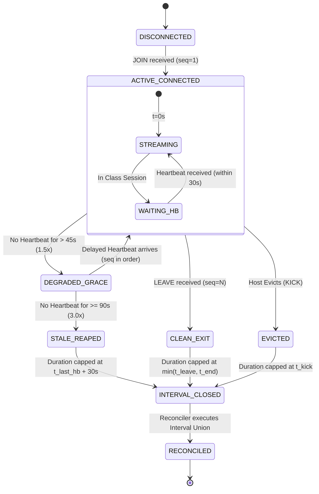

# ATTENDANCE ARCHITECTURE & EVENT LEDGER SPECIFICATION

## 1. Three-Layer Data Architecture

```
Layer A: Raw Event Ledger (participant_connection_events)
   ├── Immutable append-only log of JOIN, HEARTBEAT, LEAVE, DISCONNECT, KICK
   ├── Server-authoritative clock_timestamp() and sequence numbers
   ├── Server-generated idempotency_key = sha256(room_id || conn_id || seq_no)
   └── Permanent retention for academic accreditation auditability

Layer B: Calculated Attendance (attendance_records)
   ├── Reconciled net connected seconds via Lebesgue-measure interval union
   ├── Presence classification (present, partial, absent) based on scheduled session duration
   └── Preserves original calculated values upon subsequent manual overrules

Layer C: Manual Overrule Audit Ledger (attendance_overrule_audit_log)
   ├── Transactionally coupled audit trail for all manual adjustments
   ├── Records actor, timestamp, prior/new status, prior/new duration
   └── Mandatory justification constraint (char_length(trim(reason)) >= 10)
```

---

## 2. Attendance State Machine & Reaped Session Duration Capping



### 2.1 The Timing Parameters:
- $T_{\text{hb}} = 30\text{ seconds}$: Client heartbeat emission interval.
- $T_{\text{grace}} = 45\text{ seconds}$ ($1.5 \times T_{\text{hb}}$): Network jitter and cellular handover tolerance.
- $T_{\text{expiry}} = 90\text{ seconds}$ ($3.0 \times T_{\text{hb}}$): Reaper declares socket dead.
- **Duration Capping Rule**:
  When a silent connection is reaped at $T+90\text{s}$, the credited connection interval is closed at:
  $$t_{\text{close}} = t_{\text{last\_heartbeat}} + 30\text{ seconds}$$
  **Result**: Silent connections do not accumulate 60 seconds of phantom attendance time while waiting for reaper sweeps.

---

## 3. Mathematical Proof of Interval-Union Idempotency

### 3.1 Formal Definition:
Let student $u$ maintain $M$ concurrent device connections during class session $S$ bounded by $[T_{\text{start}}, T_{\text{end}}]$. Each device $m \in \{1, \dots, M\}$ yields a set of raw connection intervals:
$$\mathcal{C}_m = \{ [s_{m,1}, e_{m,1}], [s_{m,2}, e_{m,2}], \dots \}$$
Each interval is clipped to the session boundaries:
$$s'_{m,i} = \max(s_{m,i}, T_{\text{start}}), \quad e'_{m,i} = \min(e_{m,i}, T_{\text{end}})$$

The total attendance duration is defined as the Lebesgue measure $\mu$ of the union of all intervals:
$$\text{Duration}(u) = \mu \left( \bigcup_{m=1}^{M} \bigcup_{i} [s'_{m,i}, e'_{m,i}] \right)$$

### 3.2 Idempotency Theorem:
$$\mu \left( \mathcal{I} \cup \mathcal{I} \right) = \mu(\mathcal{I})$$
Re-running the reconciliation worker over the same raw connection events produces identical net seconds regardless of worker restarts, packet duplicates, or out-of-order deliveries.

### 3.3 Multi-Tab Non-Overlapping Verification:
- **Tab 1**: Connected from 10:00 to 10:30 (1800s).
- **Tab 2**: Connected from 10:15 to 10:45 (1800s).
- **Overlapping segment**: 10:15 to 10:30 (15 min).
- **Reconciled Union**: 10:00 to 10:45 = 45 minutes = **2,700 seconds** (never 3,600s).
